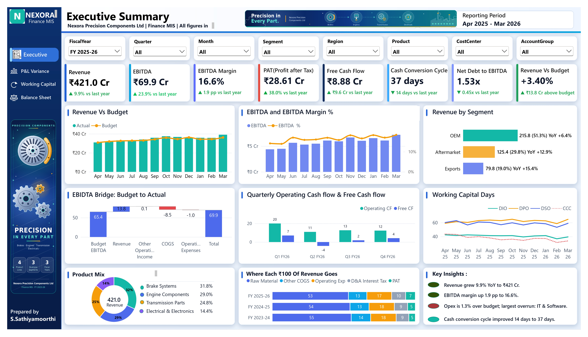

<div align="center">
    
# 📊 Nexora Precision Components Ltd. — Finance MIS & Executive Dashboard

### Power BI Dashboard | Corporate Finance & Management Reporting

**Executive Summary · P&L Analysis · Working Capital · Balance Sheet · Financial Performance**

📅 **Reporting Period:** April 2025 – March 2026 (FY 2025–26)


</div>


## 📌 Project Overview

This project presents an interactive **Finance MIS & Executive Dashboard** developed for Nexora Precision Components Ltd. using Microsoft Power BI.

The dashboard provides a consolidated view of financial performance, profitability, budget achievement, revenue contribution, operating cash flow, and working capital efficiency.

It is designed to simulate a real-world corporate Finance MIS reporting environment, helping finance teams and management monitor business performance, identify financial deviations, and make informed decisions.

The solution brings multiple financial reporting areas into a centralized executive reporting system.

---

## 🖼️ Dashboard Preview

### 01. Executive Summary:

The Executive Summary provides management with an overall view of financial performance through interactive KPI cards, financial trends, budget comparisons, and business insights.



<br>

---

## 📊 Key Financial Performance Indicators

The dashboard tracks the following financial KPIs:

| Financial KPI | Dashboard Value |
|---|---:|
| Total Revenue | ₹421.00 Cr |
| EBITDA | ₹69.90 Cr |
| EBITDA Margin | 16.6% |
| Profit After Tax | ₹28.61 Cr |
| Free Cash Flow | ₹8.88 Cr |
| Cash Conversion Cycle | 37 Days |
| Net Debt / EBITDA | 1.53x |
| Revenue vs Budget | +3.4% |

*All figures are in INR Crore unless otherwise specified.*

---

## 📈 Dashboard Features & Business Analysis

### 1️⃣ Executive Summary

Provides a high-level overview of the organization's financial health.

**Key Analysis:**
- Revenue and EBITDA performance.
- EBITDA margin and profitability.
- Profit After Tax (PAT).
- Free Cash Flow.
- Cash Conversion Cycle.
- Net Debt / EBITDA.
- Revenue versus budget achievement.

### 2️⃣ P&L Variance Analysis

Analyzes actual financial performance against budget and previous-year performance.

**Key Analysis:**
- Budget vs Actual Revenue.
- EBITDA variance analysis.
- Revenue growth and profitability trends.
- Operating income and expense analysis.
- Cost of Goods Sold (COGS).
- Operating expense monitoring.
- EBITDA bridge from budget to actual.

### 3️⃣ Working Capital Analysis

Monitors the organization's working capital efficiency and cash management.

**Key Analysis:**
- Days Sales Outstanding (DSO).
- Days Inventory Outstanding (DIO).
- Days Payable Outstanding (DPO).
- Cash Conversion Cycle (CCC).
- Operating Cash Flow.
- Free Cash Flow.
- Working capital movement and trends.

### 4️⃣ Balance Sheet Analysis

Provides insights into financial position and capital structure.

**Key Analysis:**
- Assets and liabilities.
- Working capital position.
- Debt and equity structure.
- Net debt monitoring.
- Financial stability indicators.

---

## 💡 Key Business Insights

Based on the Executive Summary dashboard:

| Area | Business Insight |
|---|---|
| Revenue | Revenue reached ₹421 Cr, growing 9.9% year over year. |
| EBITDA | EBITDA increased by 23.9% to ₹69.90 Cr. |
| Profitability | EBITDA margin improved by 1.9 percentage points to 16.6%. |
| PAT | Profit After Tax increased by 38.0% to ₹28.61 Cr. |
| Cash Flow | Free Cash Flow reached ₹8.88 Cr. |
| Working Capital | Cash Conversion Cycle improved by 14 days to 37 days. |
| Budget Performance | Revenue exceeded budget by 3.4%. |
| Segment Performance | OEM contributed 51.3% of revenue. |
| Product Mix | Brake Systems contributed the largest revenue share at 31.8%. |

---

## 📊 Visualizations Used

The dashboard incorporates the following Power BI visuals:

- KPI Cards — Financial performance monitoring.
- Combo Charts — Revenue vs Budget and EBITDA performance.
- Horizontal Bar Charts — Revenue by business segment.
- Waterfall Chart — EBITDA Budget to Actual bridge.
- Doughnut Chart — Product revenue mix.
- Stacked Bar Charts — Revenue cost composition.
- Clustered Column Charts — Operating and free cash flow.
- Line Charts — Working capital movement.
- Interactive Slicers — Fiscal Year, Quarter, Month, Segment, Region, Product, Cost Centre, and Account Group.

---

## 🎛️ Interactive Dashboard Filters

The dashboard includes multiple filtering options for detailed financial analysis:

| Filter | Purpose |
|---|---|
| Fiscal Year | Analyze financial year performance |
| Quarter | Compare quarterly performance |
| Month | Monitor monthly trends |
| Segment | Analyze business segments |
| Region | Compare regional performance |
| Product | Review product-level performance |
| Cost Centre | Monitor departmental expenses |
| Account Group | Analyze financial account categories |

---

## 🛠️ Tools & Technologies

| Technology | Application |
|---|---|
| Microsoft Power BI | Interactive financial dashboard |
| Power Query | Data cleaning and transformation |
| DAX | Financial KPIs and calculations |
| Microsoft Excel | Financial data preparation |
| Data Visualization | Management reporting and analysis |

---

## 📂 Repository Structure

```text
Nexora-Finance-MIS-Dashboard/
│
├── README.md
│
├── assets/
│   └── screenshots/
│       ├── 01_Executive_summary.png
│       ├── 02_PL_Variance.png
│       ├── 03_Working_Capital.png
│       └── 04_Balance_Sheet.png
│
├── dataset/
│   └── Nexora_Finance_MIS_Dataset.xlsx
│
└── dashboard/
    ├── Nexora_Finance_MIS_Dashboard.pbix
    └── Nexora_Finance_MIS_Dashboard.pdf
```

*The structure above is a suggested repository layout. Add only the files available in your project.*

---

## 🚀 How to Explore the Project

1. Clone or download this GitHub repository.
2. Open the Excel dataset to explore the financial source data.
3. Open the `.pbix` file using Power BI Desktop.
4. Explore the Executive Summary and other available dashboard pages.
5. Apply different filters to analyze financial performance across reporting periods and business dimensions.

---

## 🎯 Skills Demonstrated

- Financial MIS Reporting
- Financial Statement Analysis
- P&L Variance Analysis
- Budget vs Actual Analysis
- Working Capital Management
- Cash Flow Analysis
- EBITDA & Profitability Analysis
- Power BI Dashboard Development
- DAX Calculations
- Power Query & Data Transformation
- Business Intelligence
- Management Decision Support

---

## 👨‍💻 Author

**S. Sathiyamoorthi**

Aspiring Data Analyst | Power BI Developer

**Areas of Interest:** Financial Analytics | MIS Reporting | Business Intelligence | Data Visualization

🔗 LinkedIn:[www.linkedin.com/in/sathiyamoorthi-s-mis]

---

⭐ If you find this project useful, consider giving this repository a star!

*Disclaimer: Nexora Precision Components Ltd. is used as a portfolio-project business scenario. The dashboard figures are illustrative and should not be interpreted as audited financial statements or actual company disclosures.*
