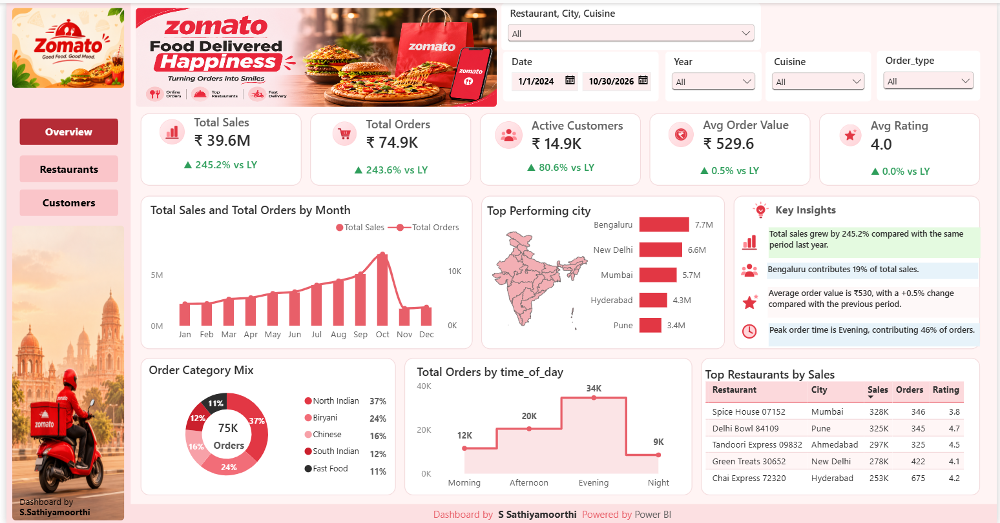
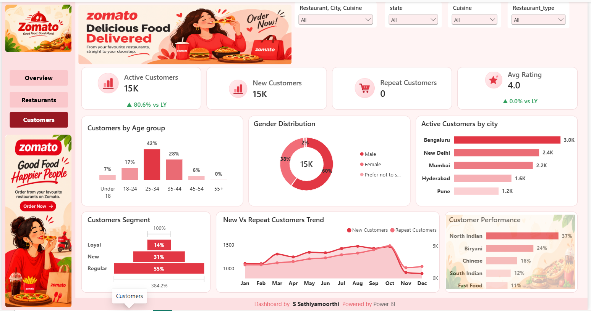
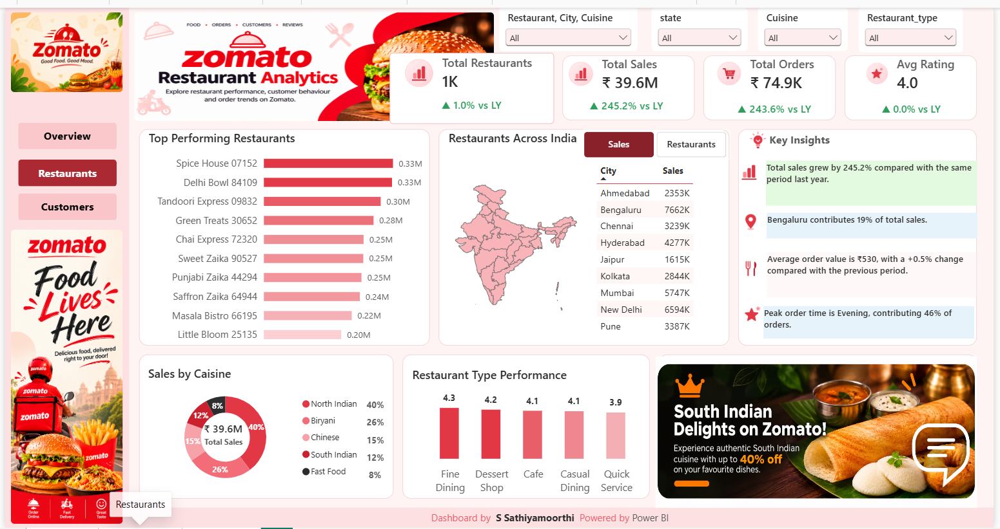

<div align="center">

# 🍕 Zomato — Sales & Customer Analytics Dashboard

### Power BI Dashboard | Food Delivery & Restaurant Analytics

**Business Intelligence · Sales Performance · Customer Insights · Restaurant Analytics**

📅 **Reporting Period:** January 2024 – October 2026
[](https://app.powerbi.com/view?r=eyJrIjoiY2E2OGU1ZGQtM2NhNC00NzA0LWFkODEtMWFiNzY5Njc0ZmE4IiwidCI6ImM5YzUwODQ4LWIwM2EtNGJlNC1iNjU1LTZlZGQ3ZmI4MWM1YSJ9)


</div>


## 📊 Project Overview

This project presents an interactive **Zomato Sales & Customer Analytics Dashboard** built using Microsoft Power BI.

The dashboard provides a comprehensive view of restaurant sales, customer behavior, order trends, city-wise performance, and food category preferences.

It transforms business data into meaningful visual insights, helping stakeholders understand sales performance, identify customer trends, and make data-driven business decisions.

The dashboard consists of **3 interactive pages**:

1. Executive Overview
2. Customer Analytics
3. Restaurants Analytics

---

## 🖼️ Dashboard Preview

### 1️⃣ Executive Overview:

The Executive Overview provides a complete picture of Zomato's overall business performance.

**Key highlights:**
- Total Sales and Total Orders
- Active Customers
- Average Order Value (AOV)
- Average Restaurant Rating
- Monthly Sales and Order Trends
- Top Performing Cities
- Order Category Distribution
- Orders by Time of Day
- Top Restaurants by Sales
- Key Business Insights



<br>

### 2️⃣ Customer Analytics:

The Customer Analytics page focuses on customer demographics, customer segmentation, and purchasing behavior.

**Key highlights:**
- Active Customers
- New Customers
- Repeat Customers
- Average Customer Rating
- Customers by Age Group
- Gender Distribution
- Active Customers by City
- Customer Segmentation
- New vs Repeat Customer Trends
- Customer Performance by Food Category



<br>

### 3 Restaurants Analytics:

The Restaurants view provides management with a comprehensive overview of partner performance through interactive KPI cards, regional sales distributions, cuisine and restaurant-type breakdowns, and actionable business insights



<br>
---

## 📈 Key Business Metrics

The dashboard highlights the following business KPIs:

| KPI | Dashboard Value |
|---|---:|
| Total Sales | ₹39.6M |
| Total Orders | 74.9K |
| Active Customers | 14.9K |
| Average Order Value | ₹529.6 |
| Average Rating | 4.0 |
| Customer Count | 15K |

*Values are based on the dashboard screenshots and may change when filters are applied.*

---

## 🎯 Business Questions Answered

This dashboard helps answer important business questions:

- How are total sales and orders performing month over month?
- Which cities generate the highest sales?
- Which food categories contribute most to total orders?
- What are the peak ordering times?
- Which restaurants generate the highest sales?
- What is the distribution of customers by age and gender?
- How many customers are new, repeat, or regular?
- How does customer behavior vary across different cities?
- Which food categories perform best among customers?

---

## 🔍 Dashboard Features

**Interactive Filters & Slicers**

The dashboard includes interactive filters to explore business performance:

- Restaurant / City / Cuisine
- State
- Cuisine
- Restaurant Type
- Order Type
- Year
- Date Range

**Data Visualization**

- KPI Cards
- Bar Charts
- Donut Charts
- Line Charts
- Trend Analysis
- Geographic Performance Visualization
- Customer Segmentation Charts
- Restaurant Performance Tables

---

## 🛠️ Tools & Technologies

| Tool | Purpose |
|---|---|
| Power BI Desktop | Dashboard development and visualization |
| Microsoft Excel | Data storage and preparation |
| Power Query | Data cleaning and transformation |
| DAX | Calculated measures and KPI analysis |

---

## 📂 Project Structure

```text

Zomato-Sales-Customer-Analytics/

│

├── README.md

│

├── assets/

│   └── screenshots/

│       ├── 01_overview.png

│       └── 02_customers.png

        └── 03_Restaurants.png

│

├── dataset/

│   └── Zomato_Dataset.xlsx

│

└── dashboard/

  └── Zomato_Analytics_Dashboard.pbix

```

*Update the file names and folders according to the files you actually upload to GitHub.*

---

## 💡 Key Insights

The dashboard helps identify several important business patterns:

- **Sales Performance:** Monitor monthly sales and order growth.
- **City Performance:** Compare sales contribution across major cities.
- **Customer Demographics:** Understand customer distribution by age and gender.
- **Ordering Behavior:** Identify popular ordering periods throughout the day.
- **Restaurant Performance:** Compare restaurants based on sales and customer ratings.
- **Customer Segmentation:** Analyze loyal, new, and regular customers.

---

## 🚀 How to Explore the Project

1. Clone or download this GitHub repository.
2. Open the `.pbix` file using Power BI Desktop.
3. Load the required dataset if prompted.
4. Explore the dashboard using the available slicers and filters.
5. Navigate between the Overview and Customers pages to analyze business performance.

---

## 👨‍💻 Author

**S. Sathiyamoorthi**
*Power BI | Data Analytics | Business Intelligence*
LinkedIn: https:[www.linkedin.com/in/sathiyamoorthi-s-mis]


This project demonstrates practical skills in data visualization, business analytics, dashboard development, and transforming raw data into meaningful business insights.

---

⭐ **If you find this project useful, don't forget to give this repository a star!**
