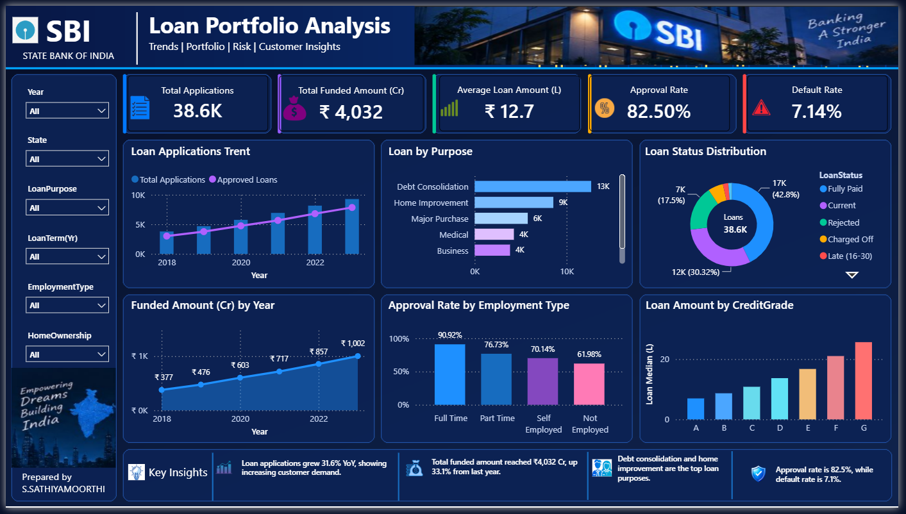

<div align="center">
    
# 🏦 SBI Loan Portfolio Analysis — Lending, Risk & Customer Intelligence

### Power BI Dashboard | Banking & Credit Risk Analytics

**Trends · Portfolio · Risk · Customer Insights**

📅 **Reporting Period:** 2018 – Present (Multi-Year Portfolio View)


</div>


## 📌 Project Overview

This project presents an interactive **Loan Portfolio Analysis Dashboard** developed using Microsoft Power BI to evaluate loan origination trends, disbursement volume, approval and default risk, and borrower profile patterns.

The dashboard provides a consolidated view of total applications, funded amounts, average loan ticket size, approval rates, default rates, loan purposes, loan status distribution, and credit grade exposure.

It is designed to simulate a real-world banking and credit analytics reporting environment, helping risk teams and leadership monitor portfolio growth, identify credit risk pockets, and make data-driven lending decisions.

The solution brings application volume, funded exposure, portfolio health, and borrower risk insights into a centralized interactive reporting view.

---

## 🖼️ Dashboard Preview

### 01. Loan Portfolio Analysis (Executive & Risk View):

The Loan Portfolio Analysis dashboard provides management with an overall view of lending performance and credit risk through interactive KPI cards, multi-year application and funding trends, loan purpose and status breakdowns, employment approval rates, credit grade exposure, and key business insights.



<br>


## 📊 Key Loan Portfolio Performance Indicators

The dashboard tracks the following lending and risk KPIs:

| Portfolio KPI | Dashboard Value |
|---|---:|
| Total Applications | 38.6K |
| Total Funded Amount | ₹4,032 Cr |
| Average Loan Amount | ₹12.7 L |
| Approval Rate | 82.50% |
| Default Rate | 7.14% |
| YoY Application Growth | +31.6% |
| YoY Funded Amount Growth | +33.1% |

*Monetary figures are reported in INR Crore (Cr) and INR Lakhs (L) as displayed on the dashboard.*[cite: 9]

---

## 📈 Dashboard Features & Business Analysis

### 1️⃣ Portfolio Growth & Disbursement Trends

Provides a multi-year view of loan demand and capital deployment across years[cite: 9].

**Key Analysis:**
- Total applications versus approved loans trend over time.
- Annual funded amount trajectory (growing from ₹377 Cr in 2018 to ₹1,002 Cr in the latest full year shown).
- Year-over-year expansion in application demand and funded volume.
- Impact of filtering by year, loan purpose, loan term, employment type, or home ownership[cite: 9].

### 2️⃣ Loan Purpose & Portfolio Status Mix

Analyzes why borrowers take loans and how active and closed loans are distributed across statuses[cite: 9].

**Key Analysis:**
- Loan volume by purpose (Debt Consolidation at 13K, Home Improvement at 9K, Major Purchase at 6K, Medical at 4K, and Business at 4K).
- Loan status distribution across 38.6K total loans (Fully Paid at 17K / 42.8%, Current at 12K / 30.32%, Rejected at 7K / 17.5%, plus Charged Off and Late 16–30 categories).
- Identification of core borrowing drivers and delinquency/write-off exposure[cite: 9].

### 3️⃣ Credit Risk & Borrower Segmentation

Evaluates approval performance and median loan ticket sizes across borrower employment and credit grades[cite: 9].

**Key Analysis:**
- Approval rate comparison by employment type (Full Time at 90.92%, Part Time at 76.73%, Self Employed at 70.14%, and Not Employed at 61.98%).
- Median loan amount (in Lakhs) across credit grades A through G.
- Balance between approval rate (82.5%) and default rate (7.14%).
- Automated key insight callouts summarizing top growth and risk takeaways[cite: 9].

---

## 💡 Key Business Insights

Based on the Loan Portfolio Analysis dashboard[cite: 9]:

| Area | Business Insight |
|---|---|
| Demand Growth | Loan applications grew 31.6% YoY, reflecting rising customer borrowing demand. |
| Funded Volume | Total funded amount reached ₹4,032 Cr, increasing 33.1% compared to last year. |
| Top Loan Purposes | Debt consolidation (13K) and home improvement (9K) are the leading loan purposes. |
| Approval vs. Default | Overall approval rate stands at 82.5% (82.50%), while the default rate is 7.1% (7.14%). |
| Employment Impact | Full-time borrowers show the highest approval rate at 90.92%, compared to 61.98% for not-employed applicants. |
| Credit Grade Ticket Size | Median loan amounts scale upward across risk grades from Grade A toward higher-tier grades such as F and G. |
| Portfolio Status | Fully paid loans represent the largest share (17K / 42.8%), followed by current loans (12K / 30.32%)[cite: 9]. |

---

## 📊 Visualizations Used

The dashboard incorporates the following Power BI visuals[cite: 9]:

- KPI Cards — Total applications, funded amount, average loan size, approval rate, and default rate tracking.
- Line & Area Charts — Multi-year trends for total applications, approved loans, and funded amount.
- Horizontal Bar Charts — Loan volume breakdown by loan purpose.
- Doughnut Chart — Loan status distribution across 38.6K loans.
- Column Charts — Approval rates by employment type and median loan amount by credit grade.
- Insight Callout Strip — Highlighted summary takeaways for rapid executive review.
- Interactive Slicers — Year, State, LoanPurpose, LoanTerm(Yr), EmploymentType, and HomeOwnership filters[cite: 9].

---

## 🎛️ Interactive Dashboard Filters

The dashboard includes multiple filtering options for detailed lending and risk analysis[cite: 9]:

| Filter | Purpose |
|---|---|
| Year | Analyze annual application and funding trends |
| State | Filter portfolio performance by geographic state |
| LoanPurpose | Compare demand across debt consolidation, home improvement, business, and other purposes |
| LoanTerm(Yr) | Segment loans by tenure in years |
| EmploymentType | Evaluate borrower profiles across employment categories |
| HomeOwnership | Analyze borrower housing status segments[cite: 9] |

---

## 🛠️ Tools & Technologies

The project uses the following tools and technologies[cite: 9]:

| Technology | Application |
|---|---|
| Microsoft Power BI | Interactive loan portfolio and risk dashboard |
| Power Query | Data cleaning, shaping, and transformation |
| DAX | Approval rate, default rate, YoY growth, and median loan measures |
| Microsoft Excel | Source lending data preparation |
| Data Visualization | Credit risk and portfolio management reporting[cite: 9] |

---
## 🚀 How to Explore the Project

1. Download or clone this repository.
2. Open the dataset in Microsoft Excel to explore the source data.
3. Open the `.pbix` file using Power BI Desktop.
4. Explore the interactive dashboard.
5. Use the Financial Year and State filters to analyze different business periods and regions.

## 🎓 Skills Demonstrated

- Financial Data Analysis
- Banking KPI Analysis
- Business Intelligence
- Data Cleaning & Transformation
- Power Query
- DAX Measures
- Data Modeling
- Interactive Dashboard Development
- Customer Segmentation
- Financial Performance Reporting
- Business Insight Generation

---

## 👨‍💻 Author

**S. Sathiyamoorthi**

Aspiring Data Analyst | Power BI Developer
Areas of Interest: Financial Analytics | MIS Reporting | Risk & Lending Analytics | Business Intelligence | Data Visualization
📊 Specialization: Financial Analytics | Business Intelligence | Data Visualization
🔗 LinkedIn: [www.linkedin.com/in/sathiyamoorthi-s-mis]

---

⭐ **If you find this project useful, consider giving this repository a star!**

## 📂 Repository Structure

```text
SBI-Loan-Portfolio-Analysis/
│
├── README.md
│
├── assets/
│   └── screenshots/
│       └── 01_sbi_loan_portfolio_analysis.png
│
├── dataset/
│   └── SBI_Loan_Portfolio_Dataset.xlsx
│
└── dashboard/
    ├── SBI_Loan_Portfolio_Analysis.pbix
    └── SBI_Loan_Portfolio_Analysis.pdf
