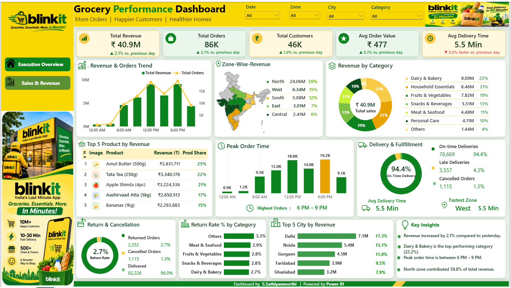

<div align="center">
    
# 🛒 Blinkit — Grocery Performance & Quick-Commerce Analytics

### Power BI Dashboard | Quick-Commerce & Delivery Operations Reporting

**Executive Overview · Sales & Revenue · Delivery & Fulfillment · Return & Cancellation Analysis**

📅 **Reporting Period:** Multi-Day / Intraday Quick-Commerce Operations


</div>


## 📌 Project Overview

This project presents an interactive **Grocery Performance Dashboard** developed for Blinkit using Microsoft Power BI to evaluate quick-commerce revenue, order velocity, delivery SLA efficiency, and return/cancellation behavior.

The dashboard provides a consolidated view of total revenue, order volume, active customers, average order value (AOV), average delivery time, regional demand, product category share, and fulfillment SLA performance.

It is designed to simulate a real-world quick-commerce operational reporting environment, helping business and logistics teams monitor hourly demand spikes, optimize delivery timelines, and minimize order cancellations or returns.

The solution brings executive KPIs, intraday order trends, geographic performance, and last-mile delivery metrics into a centralized interactive analytics system.

---

## 🖼️ Dashboard Preview

### 01. Executive Overview (Grocery Performance Dashboard):

The Executive Overview provides management with an overall view of quick-commerce performance through interactive KPI cards, intraday revenue and order trends, zone and city sales breakdowns, category contribution, top-performing SKUs, delivery SLA tracking, return/cancellation metrics, and automated business insights.



<br>


## 📊 Key Quick-Commerce Performance Indicators

The dashboard tracks the following operational and sales KPIs:

| Performance KPI | Dashboard Value |
|---|---:|
| Total Revenue | ₹40.9M |
| Total Orders | 86K |
| Total Customers | 46K |
| Average Order Value (AOV) | ₹477 |
| Average Delivery Time | 5.5 Min |
| On-Time Delivery Rate | 94.4% |
| Return Rate | 2.7% |
| Cancellation Rate | 1.3% |

*Monetary figures are reported in INR Millions (M) and INR (₹) as displayed on the dashboard[cite: 10].*

---

## 📈 Dashboard Features & Business Analysis

### 1️⃣ Revenue, Orders & Intraday Demand Trends

Provides a granular view of sales performance and hourly shopping patterns across the day[cite: 10].

**Key Analysis:**
- Total Revenue (₹40.9M, +2.1% vs. previous day), Total Orders (86K, +2.1%), and Total Customers (46K, +1.0%).
- Intraday Revenue & Orders combo trend tracking demand from 12:00 AM through late evening.
- Peak order time identification showing highest order concentration between 6 PM – 9 PM (19.2K orders), followed by 12 PM – 3 PM (18.8K orders).
- Top 5 products by revenue with product images and revenue share (Amul Butter 500g, Tata Tea 250g, Apple Shimla 4pc, Aashirvaad Atta 5kg, and Bananas 1kg)[cite: 10].

### 2️⃣ Regional & Category Performance

Analyzes geographic demand distribution and product category contribution across zones and cities[cite: 10].

**Key Analysis:**
- Zone-wise revenue breakdown across North (₹24.06M / 59%), West (₹6.34M / 15%), South (₹5.08M / 12%), East (₹3.01M / 7%), and Central (₹2.41M / 6%).
- Top 5 cities by revenue led by Delhi (₹7.1M / 17.3%), Noida (₹5.4M / 13.1%), Gurgaon (₹4.5M / 11.0%), Faridabad (₹3.9M / 9.5%), and Ghaziabad (₹3.2M / 7.9%).
- Revenue share across 7 product categories led by Dairy & Bakery (₹9.09M / 22%), Household Essentials (₹8.46M / 21%), and Fruits & Vegetables (₹7.82M / 19%)[cite: 10].

### 3️⃣ Delivery Fulfillment, Returns & Cancellations

Monitors last-mile delivery speed, SLA compliance, and post-order friction points[cite: 10].

**Key Analysis:**
- Delivery fulfillment breakdown showing 94.4% On-Time Deliveries (78,669 orders), 4.3% Late Deliveries (3,557 orders), and 1.3% Cancelled Orders (1,115 orders).
- Average delivery speed benchmark of 5.5 minutes, highlighting West as the fastest zone at 5.5 minutes.
- Order completion funnel tracking Delivered (82,226 / 96.0%), Returned (2,352 / 2.7%), and Cancelled (1,115 / 1.3%) orders.
- Category-level return rate comparison across Others (3.3%), Meat & Seafood (2.9%), Fruits & Vegetables (2.8%), Snacks & Beverages (2.8%), and Dairy & Bakery (2.7%)[cite: 10].

---

## 💡 Key Business Insights

Based on the Blinkit Grocery Performance dashboard[cite: 10]:

| Area | Business Insight |
|---|---|
| Daily Growth | Total revenue increased by 2.1% compared to the previous day, reaching ₹40.9M across 86K orders. |
| Top Category | Dairy & Bakery is the highest revenue-generating category at ₹9.09M (22.2% share), followed closely by Household Essentials (21%). |
| Peak Shopping Window | Peak order volume occurs during the evening slot between 6 PM – 9 PM (19.2K orders). |
| Regional Dominance | The North zone contributes 58.8% (₹24.06M) of total revenue, driven strongly by NCR cities (Delhi, Noida, Gurgaon, Faridabad, Ghaziabad). |
| Top SKU | Amul Butter (500g) leads product revenue at ₹38.31L (25% share among top 5 SKUs), followed by Tata Tea (250g) at ₹33.40L. |
| Delivery Efficiency | 94.4% of orders are delivered on time with an overall average delivery time of 5.5 minutes. |
| Return Friction | Overall return rate is 2.7%, with higher return rates concentrated in Others (3.3%) and perishable categories like Meat & Seafood (2.9%)[cite: 10]. |

---

## 📊 Visualizations Used

The dashboard incorporates the following Power BI visuals[cite: 10]:

- KPI Cards — Revenue, orders, customers, AOV, and average delivery time monitoring.
- Combo Chart — Intraday Revenue & Orders trend across time slots.
- Filled Map — Zone-wise geographic revenue distribution across India.
- Doughnut & Ring Charts — Category revenue share, on-time delivery SLA, and return/cancellation rates.
- Column & Horizontal Bar Charts — Peak order time slots, category return rates, and Top 5 cities by revenue.
- Custom Table with Product Images — Top 5 products by revenue with thumbnails and share percentages.
- Key Insights Panel — Automated executive summary callouts.
- Interactive Slicers — Date, Zone, City, and Category filters[cite: 10].

---

## 🎛️ Interactive Dashboard Filters

The dashboard includes multiple filtering options for granular quick-commerce analysis[cite: 10]:

| Filter | Purpose |
|---|---|
| Date | Analyze daily and period-over-period performance |
| Zone | Compare North, West, South, East, and Central zones |
| City | Drill down into city-level demand and delivery speed |
| Category | Evaluate product category revenue, orders, and return rates[cite: 10] |

---

## 🛠️ Tools & Technologies

The project leverages the following tools and technologies[cite: 10]:

| Technology | Application |
|---|---|
| Microsoft Power BI | Interactive quick-commerce performance dashboard |
| Power Query | Data cleaning, shaping, and transformation |
| DAX | Day-over-day growth, AOV, SLA %, return rate, and time-slot measures |
| Microsoft Excel | Source order, product, and logistics data preparation |
| Data Visualization | Quick-commerce operations and executive reporting[cite: 10] |

---
## 🚀 How to Explore the Project

1. Download or clone this repository.
2. Open the dataset in Microsoft Excel to explore the source data.
3. Open the `.pbix` file using Power BI Desktop.
4. Explore the interactive dashboard.
5. Use the Financial Year and State filters to analyze different business periods and regions.

## 🎓 Skills Demonstrated

- Financial Data Analysis
- Banking KPI Analysis
- Business Intelligence
- Data Cleaning & Transformation
- Power Query
- DAX Measures
- Data Modeling
- Interactive Dashboard Development
- Customer Segmentation
- Financial Performance Reporting
- Business Insight Generation

---

## 👨‍💻 Author

**S. Sathiyamoorthi**

Aspiring Data Analyst | Power BI Developer
Areas of Interest: Financial Analytics | MIS Reporting | Risk & Lending Analytics | Business Intelligence | Data Visualization

📊 Specialization: Financial Analytics | Business Intelligence | Data Visualization

🔗 LinkedIn: [www.linkedin.com/in/sathiyamoorthi-s-mis]

---

⭐ **If you find this project useful, consider giving this repository a star!**
## 📂 Repository Structure

```text
Blinkit-Grocery-Performance-Dashboard/
│
├── README.md
│
├── assets/
│   └── screenshots/
│       └── 01_blinkit_executive_overview.png
│
├── dataset/
│   └── Blinkit_Grocery_Dataset.xlsx

└── dashboard/
    ├── Blinkit_Grocery_Performance.pbix
    └── Blinkit_Grocery_Performance.pdf

