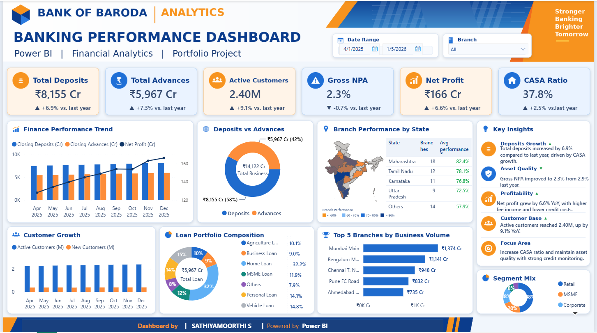

<div align="center">
    
# 🏦 Bank of Baroda — Banking Performance & Branch Analytics Dashboard

### Power BI Dashboard | Corporate Banking, Asset Quality & Branch Reporting

**Deposits & Advances · Asset Quality (NPA) · Branch Performance · Loan Portfolio Mix · Customer Growth**

📅 **Reporting Period:** April 2025 – January 2026


 
 

</div>


## 📌 Project Overview

This project presents an interactive **Banking Performance Dashboard** developed for Bank of Baroda Analytics using Microsoft Power BI to evaluate deposit mobilization, credit expansion, asset quality, and branch-level business performance.

The dashboard provides a consolidated view of total deposits, total advances, active customer base, Gross NPA ratio, net profit, CASA ratio, regional branch efficiency, and loan portfolio composition.

It is designed to simulate a real-world commercial banking MIS environment, helping banking leadership and regional managers monitor business growth, track NPA improvements, and benchmark branch performance across states.

The solution brings financial trends, geographic branch scorecards, loan product mix, and executive insights into a centralized interactive reporting system.

---

## 🖼️ Dashboard Preview

### 01. Banking Performance Dashboard (Executive Overview):

The Banking Performance Dashboard provides management with a comprehensive view of banking operations and financial health through interactive KPI cards, monthly deposit-advance-profit trends, state-wise branch performance maps, top-performing branch rankings, loan portfolio breakdowns, and automated business insights.



<br>


## 📊 Key Banking Performance Indicators

The dashboard tracks the following core banking KPIs:

| Banking KPI | Dashboard Value |
|---|---:|
| Total Deposits | ₹8,155 Cr |
| Total Advances | ₹5,967 Cr |
| Total Business (Deposits + Advances) | ₹14,122 Cr |
| Active Customers | 2.40M |
| Gross NPA | 2.3% |
| Net Profit | ₹166 Cr |
| CASA Ratio | 37.8% |
| Deposits YoY Growth | +6.9% |

*Monetary figures are reported in INR Crore (Cr) and customer counts in Millions (M) as displayed on the dashboard[cite: 11].*

---

## 📈 Dashboard Features & Business Analysis

### 1️⃣ Financial Performance, Deposits & Advances

Provides a holistic view of balance sheet expansion, profitability trajectory, and deposit-to-credit mix[cite: 11].

**Key Analysis:**
- Total Deposits (₹8,155 Cr, +6.9% vs. last year) and Total Advances (₹5,967 Cr, +7.3% vs. last year).
- Total Business composition showing ₹14,122 Cr split between Deposits (58%) and Advances (42%).
- Monthly Finance Performance Trend tracking Closing Deposits, Closing Advances, and Net Profit growth from April 2025 to December 2025.
- Net Profit growth (+6.6% YoY to ₹166 Cr) and CASA Ratio improvement (+2.5% YoY to 37.8%)[cite: 11].

### 2️⃣ Asset Quality, Loan Portfolio & Segment Mix

Analyzes credit quality, lending diversification across loan products, and customer segment contribution[cite: 11].

**Key Analysis:**
- Asset quality improvement with Gross NPA declining by 0.7 percentage points YoY from 2.9% to 2.3%.
- Loan Portfolio Composition across ₹5,967 Cr total advances: Home Loan (32.2%), Vehicle Loan (14.8%), Personal Loan (14.1%), MSME Loan (11.9%), Agriculture Loan (10.1%), Business Loan (9.0%), and Others (7.9%).
- Segment Mix breakdown across Retail, MSME, and Corporate banking segments.
- Monthly customer expansion tracking Active Customers (reaching 2.40M, +9.1% YoY) alongside New Customer acquisition[cite: 11].

### 3️⃣ Branch & State-Level Performance

Evaluates regional branch footprint, average branch efficiency scores, and top-performing branches[cite: 11].

**Key Analysis:**
- State-wise branch distribution and average performance score led by Maharashtra (18 branches, 82.4%), Tamil Nadu (12 branches, 78.1%), Karnataka (11 branches, 76.8%), Uttar Pradesh (9 branches, 72.5%), and Others (14 branches, 57.9%).
- Top 5 Branches by Business Volume led by Mumbai Main (₹1,374 Cr), Bengaluru Main (₹1,141 Cr), Chennai T. Nagar (₹948 Cr), Pune FC Road (₹832 Cr), and Ahmedabad (₹735 Cr).
- Executive Key Insights panel highlighting deposits growth, asset quality, profitability, customer base, and strategic focus areas[cite: 11].

---

## 💡 Key Business Insights

Based on the Bank of Baroda Banking Performance dashboard[cite: 11]:

| Area | Business Insight |
|---|---|
| Deposits Growth | Total deposits increased by 6.9% YoY to ₹8,155 Cr, supported by strong CASA ratio growth (37.8%). |
| Advances & Business | Total advances grew 7.3% YoY to ₹5,967 Cr, bringing total business to ₹14,122 Cr (58% Deposits, 42% Advances). |
| Asset Quality | Gross NPA improved significantly to 2.3% compared to 2.9% last year (-0.7 pp). |
| Profitability | Net profit rose 6.6% YoY to ₹166 Cr, driven by higher fee income and lower credit costs. |
| Customer Expansion | Active customer base reached 2.40M, reflecting a 9.1% year-over-year increase. |
| Portfolio Concentration | Home Loans represent the largest share of the loan book at 32.2%, followed by Vehicle Loans (14.8%) and Personal Loans (14.1%). |
| Top Branch & State | Mumbai Main leads all branches with ₹1,374 Cr in business volume, while Maharashtra leads state performance at 82.4% across 18 branches. |
| Strategic Focus | Continue expanding the low-cost CASA ratio while maintaining strong credit monitoring to preserve asset quality[cite: 11]. |

---

## 📊 Visualizations Used

The dashboard incorporates the following Power BI visuals[cite: 11]:

- KPI Cards — Deposits, advances, active customers, Gross NPA, net profit, and CASA ratio monitoring.
- Combo Chart — Monthly Closing Deposits, Closing Advances, and Net Profit trend.
- Doughnut Charts — Total Business (Deposits vs. Advances), Loan Portfolio Composition, and Segment Mix.
- Filled Map & Summary Table — State-wise branch count and average performance scorecards.
- Horizontal Bar Chart — Top 5 Branches by Business Volume.
- Clustered Column Chart — Monthly Active vs. New Customer growth trajectory.
- Key Insights Panel — Structured executive summary cards covering growth, risk, and focus areas.
- Interactive Slicers — Date Range selector and Branch filter[cite: 11].

---

## 🎛️ Interactive Dashboard Filters

The dashboard includes filtering options for targeted banking and branch analysis[cite: 11]:

| Filter | Purpose |
|---|---|
| Date Range | Select custom reporting start and end dates (e.g., 4/1/2025 – 1/5/2026) |
| Branch | Filter financial KPIs, trends, and loan mix for individual branches or all branches[cite: 11] |

---

## 🛠️ Tools & Technologies

The project leverages the following tools and technologies[cite: 11]:

| Technology | Application |
|---|---|
| Microsoft Power BI | Interactive banking performance and branch analytics dashboard |
| Power Query | Data cleaning, shaping, and transformation |
| DAX | YoY growth, CASA ratio, Gross NPA %, total business, and branch efficiency measures |
| Microsoft Excel | Source banking, branch, and loan portfolio data preparation |
| Data Visualization | Executive banking MIS and portfolio reporting[cite: 11] |

---
## 🚀 How to Explore the Project

1. Download or clone this repository.
2. Open the dataset in Microsoft Excel to explore the source data.
3. Open the `.pbix` file using Power BI Desktop.
4. Explore the interactive dashboard.
5. Use the Financial Year and State filters to analyze different business periods and regions.

## 🎓 Skills Demonstrated

- Financial Data Analysis
- Banking KPI Analysis
- Business Intelligence
- Data Cleaning & Transformation
- Power Query
- DAX Measures
- Data Modeling
- Interactive Dashboard Development
- Customer Segmentation
- Financial Performance Reporting
- Business Insight Generation

---

## 👨‍💻 Author

**S. Sathiyamoorthi**

Aspiring Data Analyst | Power BI Developer

📊 Specialization: Financial Analytics | Business Intelligence | Data Visualization

🔗 LinkedIn: [www.linkedin.com/in/sathiyamoorthi-s-mis]

---

⭐ **If you find this project useful, consider giving this repository a star!**
## 📂 Repository Structure

```text
Bank-of-Baroda-Banking-Performance-Dashboard/
│
├── README.md
│
├── assets/
│   └── screenshots/
│       └── 01_bob_banking_performance.png
│
├── dataset/
│   └── BoB_Banking_Performance_Dataset.xlsx
│
└── dashboard/
    ├── BoB_Banking_Performance.pbix
    └── BoB_Banking_Performance.pdf
