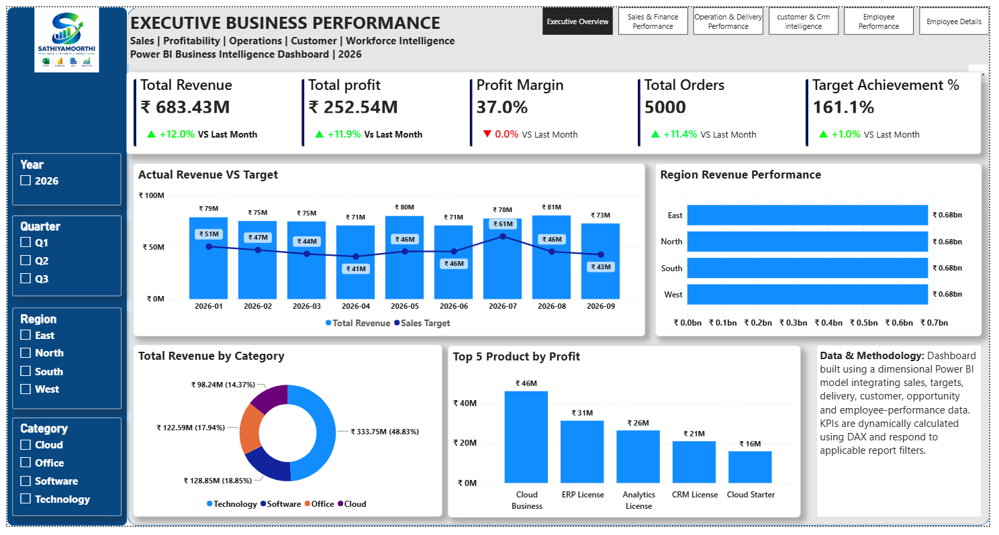
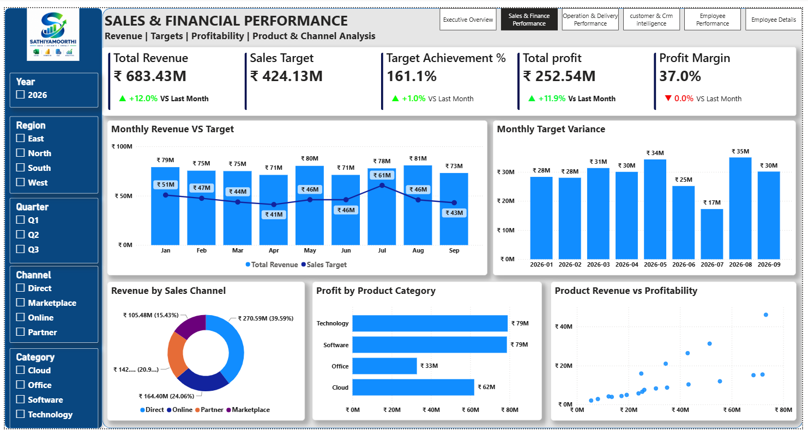
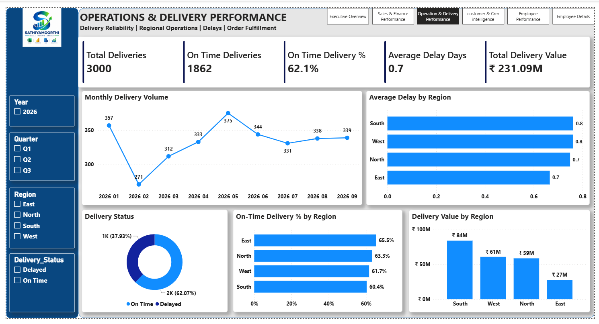
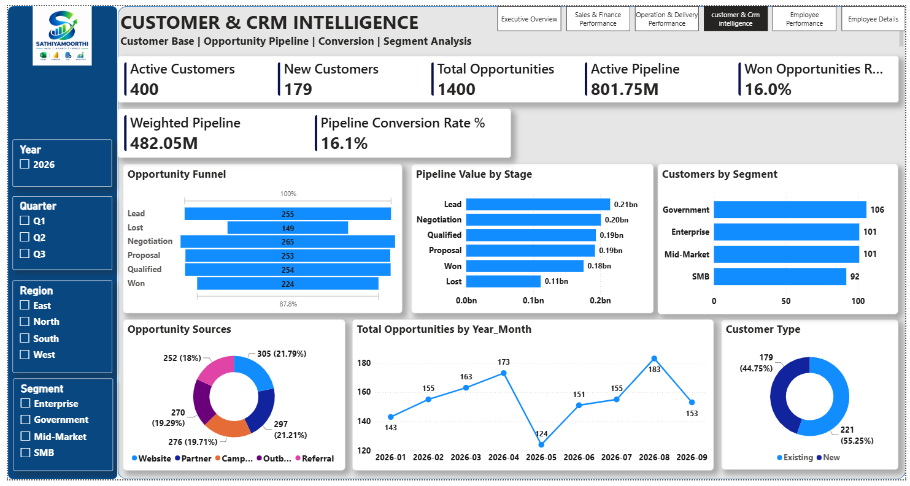
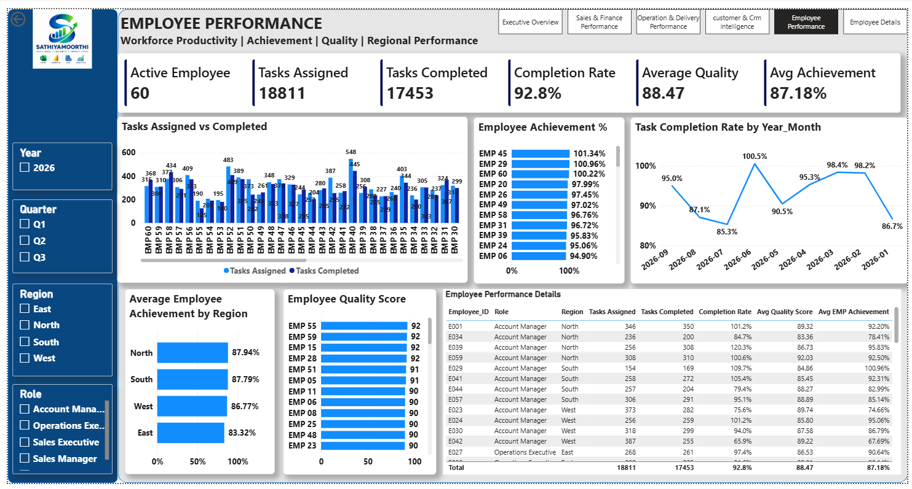
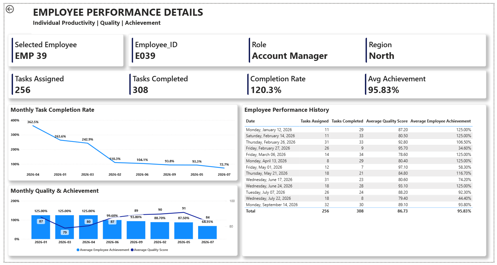

<div align="center">
    
# 📊 Enterprise Business Intelligence Dashboard — Sales, Operations, CRM & Workforce Analytics

### Power BI Dashboard | Executive & Enterprise Performance Reporting

**Executive Overview · Sales & Finance · Operations & Delivery · Customer & CRM · Employee Performance**

📅 **Reporting Period:** January 2026 – September 2026 (Q1–Q3 2026)


</div>


## 📌 Project Overview

This project presents an end-to-end **Enterprise Business Intelligence Dashboard** developed using Microsoft Power BI, integrating sales, financial targets, delivery operations, customer/CRM pipelines, and workforce productivity into a unified multi-page reporting system[cite: 17, 18, 19, 20, 21, 22].

The dashboard provides a consolidated view of total revenue, profit margins, target achievement, delivery SLAs, opportunity conversion funnels, and employee task completion across business units and regions[cite: 17, 18, 19, 20, 21, 22].

Built on a dimensional Power BI data model with dynamic DAX measures, it simulates a real-world enterprise analytics environment—enabling leadership and department heads to track KPIs, evaluate regional performance, and drill down into individual employee records.

---

## 🖼️ Dashboard Preview

### 01. Executive Business Performance:

The Executive Overview provides management with a holistic view of enterprise performance through interactive KPI cards, actual-vs-target revenue trends, regional revenue distribution, product category shares, and top-performing products by profit.



<br>

### 02. Sales & Financial Performance:

The Sales & Financial Performance view provides management with a detailed breakdown of revenue and profitability through target variance tracking, sales channel splits, category-level profit comparisons, and product revenue-vs-profitability correlation analysis.



<br>

### 03. Operations & Delivery Performance:

The Operations & Delivery Performance view provides management with a clear picture of fulfillment reliability through monthly delivery volume trends, on-time vs. delayed delivery splits, average delay days, and regional SLA comparisons.



<br>

### 04. Customer & CRM Intelligence:

The Customer & CRM Intelligence view provides management with visibility into customer growth and sales pipeline health through opportunity conversion funnels, stage-wise pipeline valuation, acquisition source breakdowns, and segment distributions.



<br>

### 05. Employee Performance:

The Employee Performance view provides management with workforce productivity insights through assigned-vs-completed task comparisons, achievement rankings, quality scores, monthly completion rates, and a searchable employee summary table.



<br>

### 06. Employee Performance Details (Drillthrough):

The Employee Performance Details drillthrough view provides granular diagnostics for an individual employee (such as `EMP 39` / `E039`), displaying role and region metadata, monthly task completion trends, quality-vs-achievement trajectories, and date-level performance logs[cite: 18].



<br>


## 📊 Key Enterprise Performance Indicators

The dashboard tracks the following cross-functional KPIs:

| Domain | Enterprise KPI | Dashboard Value |
|---|---|---:|
| Sales & Finance | Total Revenue | ₹683.43M |
| Sales & Finance | Total Profit | ₹252.54M |
| Sales & Finance | Profit Margin | 37.0% |
| Sales & Finance | Target Achievement % | 161.1% |
| Sales & Finance | Total Orders | 5,000 |
| Operations | Total Deliveries | 3,000 |
| Operations | On-Time Delivery % | 62.1% |
| Customer & CRM | Active Customers | 400 |
| Customer & CRM | Active Pipeline | ₹801.75M |
| Customer & CRM | Pipeline Conversion Rate | 16.1% |
| Workforce | Active Employees | 60 |
| Workforce | Task Completion Rate | 92.8% |

*Monetary figures are reported in INR Millions (M) and Billions (bn) as displayed on the dashboard[cite: 17, 20, 21, 22].*

---

## 📈 Dashboard Features & Business Analysis

### 1️⃣ Executive Business Performance & Sales Analytics

Provides a top-down view of commercial execution, revenue growth, and product profitability:

- Total Revenue (₹683.43M, +12.0% vs. last month), Total Profit (₹252.54M, +11.9%), Profit Margin (37.0%), and Target Achievement (161.1% against a ₹424.13M target).
- Monthly Actual Revenue vs. Target comparison and monthly target variance tracking from Jan to Sep 2026.
- Revenue by Category led by Technology (₹333.75M / 48.83%), Software (₹128.85M / 18.85%), Office (₹122.59M / 17.94%), and Cloud (₹98.24M / 14.37%).
- Revenue by Sales Channel led by Direct (₹270.59M / 39.59%) and Online (₹164.40M / 24.06%), plus Top 5 Products by Profit led by Cloud Business (₹46M) and ERP License (₹31M)[cite: 20, 22].

### 2️⃣ Operations & Delivery Performance

Monitors order fulfillment volume, transit delays, and regional delivery reliability:

- Delivery summary tracking 3,000 Total Deliveries, 1,862 On-Time Deliveries (62.1%), 0.7 Average Delay Days, and ₹231.09M Total Delivery Value.
- Monthly Delivery Volume trajectory peaking in May 2026 (375 deliveries).
- Regional SLA benchmarking showing East leading On-Time Delivery % at 65.5% (0.7 avg delay days), while South generates the highest Delivery Value (₹84M) with a 60.4% on-time rate[cite: 21].

### 3️⃣ Customer & CRM Intelligence

Analyzes customer retention, acquisition channels, and B2B sales pipeline progression:

- Customer base of 400 Active Customers split between Existing (221 / 55.25%) and New (179 / 44.75%) accounts across Government (106), Enterprise (101), Mid-Market (101), and SMB (92).
- Pipeline health tracking 1,400 Total Opportunities, ₹801.75M Active Pipeline, ₹482.05M Weighted Pipeline, 16.0% Won Opportunities Rate, and 16.1% Pipeline Conversion Rate.
- Opportunity Funnel and Stage Valuation across Lead (₹0.21bn), Negotiation (₹0.20bn), Qualified (₹0.19bn), Proposal (₹0.19bn), Won (₹0.18bn), and Lost (₹0.11bn), sourced across Website (21.79%), Partner (21.21%), Campaign (19.71%), Outbound (19.29%), and Referral (18%)[cite: 17].

### 4️⃣ Employee Performance & Individual Drillthrough

Evaluates workforce output, quality standards, and individual employee accountability:

- Workforce KPIs across 60 Active Employees tracking 18,811 Tasks Assigned, 17,453 Tasks Completed, 92.8% Completion Rate, 88.47 Average Quality Score, and 87.18% Avg Achievement.
- Regional achievement comparison led by North (87.94%) and South (87.79%), alongside top-performing employee rankings.
- Interactive drillthrough page (`Employee Performance Details`) enabling managers to inspect any employee's monthly completion rate, quality score vs. achievement trend, and daily task history.

---

## 💡 Key Business Insights

Based on the Enterprise Business Intelligence dashboard:

| Area | Business Insight |
|---|---|
| Target Outperformance | Revenue reached ₹683.43M against a ₹424.13M target, achieving 161.1% target attainment with +12.0% MoM growth[cite: 20, 22]. |
| Core Revenue Drivers | Technology (48.83%) and Direct sales (39.59%) represent the largest category and channel contributors[cite: 20, 22]. |
| High-Margin Products | Cloud Business (₹46M) and ERP License (₹31M) lead product-level profitability. |
| Delivery Bottlenecks | Overall on-time delivery stands at 62.1% (37.93% delayed), with South driving the highest delivery value (₹84M) but lowest on-time rate (60.4%)[cite: 21]. |
| Pipeline Conversion | Out of 1,400 opportunities worth ₹801.75M in active pipeline, 224 deals were won (16.0% win rate; ₹482.05M weighted pipeline)[cite: 17]. |
| Workforce Productivity | Employees achieved a 92.8% overall task completion rate and an 88.47 quality score, led regionally by North (87.94%)[cite: 19]. |

---

## 📊 Visualizations Used

The dashboard incorporates the following Power BI visuals:

- KPI Cards — Executive, financial, operational, CRM, and workforce metrics with MoM variance indicators[cite: 17, 18, 19, 20, 21, 22].
- Combo & Line Charts — Actual revenue vs. target, monthly delivery volume, opportunity trends, task completion rates, and quality-vs-achievement trajectories[cite: 17, 18, 19, 20, 21, 22].
- Funnel Chart — CRM opportunity stage conversion funnel[cite: 17].
- Doughnut Charts — Category revenue, sales channel share, delivery status, opportunity sources, and customer type splits[cite: 17, 20, 21, 22].
- Clustered & Horizontal Bar Charts — Regional revenue, target variance, profit by category, delay by region, pipeline value by stage, and employee achievement rankings[cite: 17, 19, 20, 21, 22].
- Scatter Plot — Product revenue vs. profitability correlation[cite: 22].
- Summary & Drillthrough Tables — Employee performance matrix and date-level drillthrough history[cite: 18, 19].
- Top Navigation Bar & Slicers — Seamless page-switching buttons plus `Year`, `Quarter`, `Region`, `Category`, `Channel`, `Delivery_Status`, `Segment`, and `Role` filters[cite: 17, 19, 20, 21, 22].

---

## 🎛️ Interactive Dashboard Filters

The dashboard includes contextual slicers across report pages for multi-dimensional analysis:

| Filter | Purpose |
|---|---|
| Year & Quarter | Filter performance across reporting periods (2026, Q1–Q3)[cite: 17, 19, 20, 21, 22] |
| Region | Compare East, North, South, and West business performance[cite: 17, 19, 20, 21, 22] |
| Category | Analyze Cloud, Office, Software, and Technology product lines[cite: 20, 22] |
| Channel | Evaluate Direct, Marketplace, Online, and Partner sales channels[cite: 22] |
| Delivery_Status | Isolate On Time vs. Delayed deliveries[cite: 21] |
| Segment | Segment CRM customers by Government, Enterprise, Mid-Market, and SMB[cite: 17] |
| Role | Filter workforce productivity by Account Manager, Operations Executive, Sales Executive, and Sales Manager[cite: 19] |

---

## 🛠️ Tools & Technologies

The project leverages the following tools and technologies:

| Technology | Application |
|---|---|
| Microsoft Power BI | Dimensional data modeling, multi-page report design, and drillthrough navigation[cite: 18, 20] |
| Power Query | Data cleaning, transformation, and star-schema preparation |
| DAX | Dynamic KPIs, MoM growth, target variance, weighted pipeline, and completion rate measures[cite: 17, 19, 20, 22] |
| Microsoft Excel | Source sales, targets, delivery, CRM, and employee datasets |
| Data Visualization | Enterprise executive reporting and cross-functional BI storytelling |

---
## 🚀 How to Explore the Project

1. Download or clone this repository.
2. Open the dataset in Microsoft Excel to explore the source data.
3. Open the `.pbix` file using Power BI Desktop.
4. Explore the interactive dashboard.
5. Use the Financial Year and State filters to analyze different business periods and regions.

## 🎓 Skills Demonstrated

- Financial Data Analysis
- Banking KPI Analysis
- Business Intelligence
- Data Cleaning & Transformation
- Power Query
- DAX Measures
- Data Modeling
- Interactive Dashboard Development
- Customer Segmentation
- Financial Performance Reporting
- Business Insight Generation

---

## 👨‍💻 Author

**S. Sathiyamoorthi**

Aspiring Data Analyst | Power BI Developer
Areas of Interest: Financial Analytics | MIS Reporting | Risk & Lending Analytics | Business Intelligence | Data Visualization

📊 Specialization: Financial Analytics | Business Intelligence | Data Visualization

🔗 LinkedIn: [www.linkedin.com/in/sathiyamoorthi-s-mis]

## 📂 Repository Structure

```text
Enterprise-Business-Intelligence-Dashboard/
│
├── README.md
│
├── assets/
│   └── screenshots/
│       ├── 01_executive_overview.png
│       ├── 02_sales_finance.png
│       ├── 03_operations_delivery.png
│       ├── 04_customer_crm.png
│       ├── 05_employee_performance.png
│       └── 06_employee_drillthrough.png
│
├── dataset/
│   └── Enterprise_BI_Dataset.xlsx
│
└── dashboard/
    ├── Enterprise_Business_Intelligence.pbix
    └── Enterprise_Business_Intelligence.pdf
