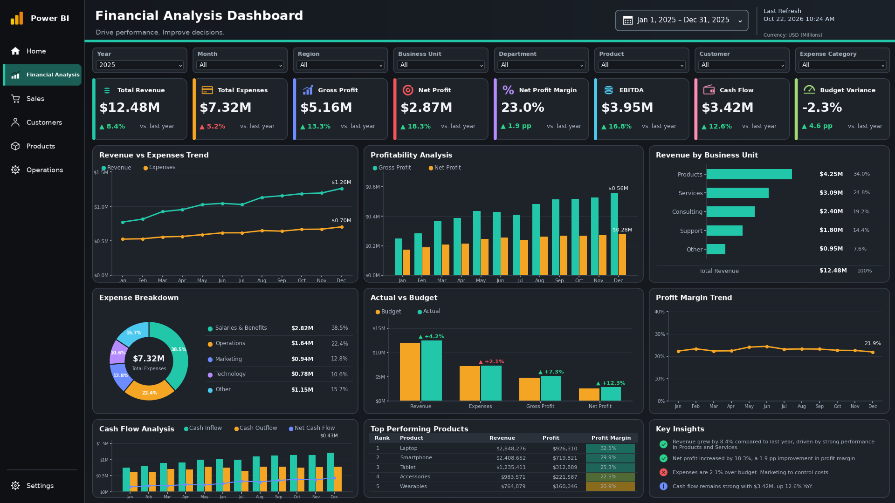

<div align="center">
    
# 📊 Financial Analysis Dashboard — Corporate Profitability, Budget & Cash Flow Intelligence

### Power BI Dashboard | Corporate Finance, FP&A & Executive Reporting

**Revenue & Expenses · Profitability Analysis · Actual vs. Budget · Cash Flow · Product Margins**

📅 **Reporting Period:** January 1, 2025 – December 31, 2025 (FY 2025)


</div>


## 📌 Project Overview

This project presents an executive dark-mode **Financial Analysis Dashboard** developed using Microsoft Power BI to track revenue expansion, cost structure, profitability margins, budget variance, and operating cash flow across business units.

The dashboard provides a consolidated view of total revenue, total expenses, gross profit, net profit, net profit margin, EBITDA, cash flow, budget variance, and product-level profitability.

Designed to simulate a modern corporate FP&A and executive reporting environment, it helps leadership monitor monthly financial trajectories, benchmark actual performance against budget targets, control operating expenses, and identify top-margin product lines.

---

## 🖼️ Dashboard Preview

### 01. Financial Analysis (Executive FP&A View):

The Financial Analysis view provides management with an overall view of financial performance through YoY KPI cards, monthly revenue-vs-expense and profitability trends, business unit revenue breakdowns, expense allocations, actual-vs-budget comparisons, cash flow movements, top-performing products, and automated key insights[cite: 25].



<br>


## 📊 Key Financial Performance Indicators (FY 2025)

The dashboard tracks the following core financial and FP&A KPIs:

| Financial KPI | Dashboard Value | YoY Variance |
|---|---:|---:|
| Total Revenue | $12.48M | ▲ +8.4% vs last year |
| Total Expenses | $7.32M | ▲ +5.2% vs last year |
| Gross Profit | $5.16M | ▲ +13.3% vs last year |
| Net Profit | $2.87M | ▲ +18.3% vs last year |
| Net Profit Margin | 23.0% | ▲ +1.9 pp vs last year |
| EBITDA | $3.95M | ▲ +16.8% vs last year |
| Cash Flow | $3.42M | ▲ +12.6% vs last year |
| Budget Variance | -2.3% | ▲ +4.6 pp vs last year[cite: 25] |

*All monetary figures are reported in USD Millions (M) unless otherwise specified[cite: 25].*

---

## 📈 Dashboard Features & Business Analysis

### 1️⃣ Revenue, Expense & Profitability Trends

Provides a multi-month view of top-line growth, cost discipline, and bottom-line expansion across FY 2025:

- Monthly **Revenue vs Expenses Trend** showing steady revenue growth reaching $1.26M in December against $0.70M in monthly expenses.
- Monthly **Profitability Analysis** comparing Gross Profit (peaking at $0.56M in December) and Net Profit (reaching $0.28M in December).
- **Profit Margin Trend** tracking monthly net margin stability throughout the year, closing at 21.9% in December with a full-year average of 23.0% (+1.9 pp YoY)[cite: 25].

### 2️⃣ Business Unit Mix, Expense Breakdown & Budget Variance

Analyzes revenue contribution across business units, operating expense allocation, and actual-vs-budget execution:

- **Revenue by Business Unit** across $12.48M total revenue: Products ($4.25M / 34.0%), Services ($3.09M / 24.8%), Consulting ($2.40M / 19.2%), Support ($1.80M / 14.4%), and Other ($0.95M / 7.6%).
- **Expense Breakdown** across $7.32M total expenses: Salaries & Benefits ($2.82M / 38.5%), Operations ($1.64M / 22.4%), Marketing ($0.94M / 12.8%), Technology ($0.78M / 10.6%), and Other ($1.15M / 15.7%).
- **Actual vs Budget** comparison highlighting positive variances in Revenue (+4.2%), Gross Profit (+7.3%), and Net Profit (+12.3%), alongside a +2.1% expense overrun against budget[cite: 25].

### 3️⃣ Cash Flow Analysis & Top Product Margins

Monitors liquidity generation and product-level revenue and margin rankings:

- **Cash Flow Analysis** tracking monthly Cash Inflow, Cash Outflow, and Net Cash Flow (reaching $0.43M in December and $3.42M total for the year, up 12.6% YoY).
- **Top Performing Products** table ranking the top 5 products by revenue, profit, and profit margin: Laptop ($2,848,276 revenue / $926,310 profit / 32.5% margin), Smartphone ($2,408,652 / $719,821 / 29.9%), Tablet ($1,235,411 / $312,889 / 25.3%), Accessories ($983,571 / $221,587 / 22.5%), and Wearables ($764,879 / $160,046 / 20.9%).
- **Key Insights** summary panel highlighting revenue drivers, margin expansion, marketing cost control opportunities, and cash flow strength[cite: 25].

---

## 💡 Key Business Insights

Based on the Financial Analysis dashboard:

| Area | Business Insight |
|---|---|
| Revenue Growth | Revenue grew by 8.4% YoY to $12.48M (beating budget by 4.2%), driven primarily by Products ($4.25M) and Services ($3.09M). |
| Bottom-Line Expansion | Net profit increased by 18.3% YoY to $2.87M (+12.3% vs. budget), reflecting a 1.9 pp improvement in net profit margin (23.0%). |
| Operating Leverage | Gross profit rose 13.3% to $5.16M and EBITDA grew 16.8% to $3.95M, demonstrating strong operating leverage. |
| Cost Control Focus | Total expenses reached $7.32M (+5.2% YoY), running 2.1% over budget—with Salaries & Benefits (38.5%) and Operations (22.4%) as the largest cost drivers and Marketing flagged for tighter cost control. |
| Cash Flow Strength | Operating cash flow remained healthy at $3.42M, up 12.6% compared to last year. |
| Top Margin Product | Laptops led both top-line product revenue ($2.85M) and profitability ($926K) at a 32.5% profit margin[cite: 25]. |

---

## 📊 Visualizations Used

The dashboard incorporates the following Power BI visuals:

- KPI Cards — Revenue, expenses, gross profit, net profit, margin, EBITDA, cash flow, and budget variance with YoY indicators[cite: 25].
- Line Charts — Monthly Revenue vs. Expenses trend and Profit Margin trajectory[cite: 25].
- Clustered Column & Combo Charts — Monthly Gross vs. Net Profit, Actual vs. Budget variance, and Cash Inflow/Outflow/Net Cash Flow analysis[cite: 25].
- Horizontal Bar Chart — Revenue breakdown by Business Unit[cite: 25].
- Doughnut Chart — Expense Breakdown across cost categories[cite: 25].
- Ranked Summary Table with Conditional Formatting — Top Performing Products with heatmap-styled profit margin indicators[cite: 25].
- Key Insights Callout Card — Structured executive summary with status icons[cite: 25].
- Left Navigation Rail & Slicers — Multi-page navigation (`Home`, `Financial Analysis`, `Sales`, `Customers`, `Products`, `Operations`) plus 8 interactive slicers and a date range picker[cite: 25].

---

## 🎛️ Interactive Dashboard Filters

The dashboard includes multiple filtering options for granular financial and FP&A analysis:

| Filter | Purpose |
|---|---|
| Year & Month | Analyze annual and monthly financial performance (e.g., `2025`)[cite: 25] |
| Region | Compare geographic financial results[cite: 25] |
| Business Unit | Evaluate Products, Services, Consulting, Support, and Other units[cite: 25] |
| Department | Monitor departmental budgets and operating spend[cite: 25] |
| Product | Drill down into product-specific revenue and profit margins[cite: 25] |
| Customer | Filter financial performance by customer accounts or segments[cite: 25] |
| Expense Category | Isolate Salaries & Benefits, Operations, Marketing, and Technology spend[cite: 25] |

---

## 🛠️ Tools & Technologies

The project leverages the following tools and technologies:

| Technology | Application |
|---|---|
| Microsoft Power BI | Dark-themed executive financial & FP&A dashboard design[cite: 25] |
| Power Query | Data cleaning, transformation, and financial model shaping |
| DAX | YoY growth, percentage-point (pp) variance, budget variance %, EBITDA, and margin measures[cite: 25] |
| Microsoft Excel | Source general ledger, budget, and cash flow data preparation |
| Data Visualization | Corporate FP&A storytelling and conditional formatting[cite: 25] |

---
## 🚀 How to Explore the Project

1. Download or clone this repository.
2. Open the dataset in Microsoft Excel to explore the source data.
3. Open the `.pbix` file using Power BI Desktop.
4. Explore the interactive dashboard.
5. Use the Financial Year and State filters to analyze different business periods and regions.

## 🎓 Skills Demonstrated

- Financial Data Analysis
- Banking KPI Analysis
- Business Intelligence
- Data Cleaning & Transformation
- Power Query
- DAX Measures
- Data Modeling
- Interactive Dashboard Development
- Customer Segmentation
- Financial Performance Reporting
- Business Insight Generation

---

## 👨‍💻 Author

**S. Sathiyamoorthi**

Aspiring Data Analyst | Power BI Developer
Areas of Interest: Financial Analytics | MIS Reporting | Risk & Lending Analytics | Business Intelligence | Data Visualization

📊 Specialization: Financial Analytics | Business Intelligence | Data Visualization

🔗 LinkedIn: [www.linkedin.com/in/sathiyamoorthi-s-mis]

⭐ **If you find this project useful, consider giving this repository a star!**


## 📂 Repository Structure

```text
Financial-Analysis-Dashboard/
│
├── README.md
│
├── assets/
│   └── screenshots/
│       └── 01_financial_analysis.png
│
├── dataset/
│   └── Financial_Analysis_Dataset.xlsx
│
└── dashboard/
    ├── Financial_Analysis_Dashboard.pbix
    └── Financial_Analysis_Dashboard.pdf
