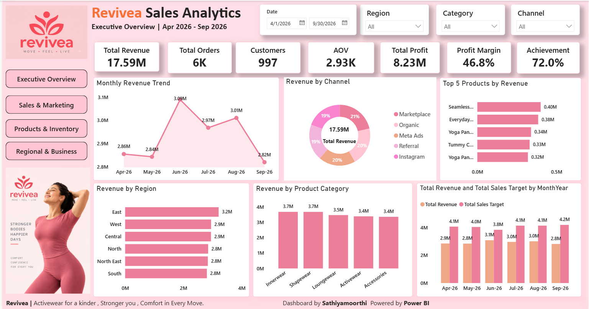

<div align="center">
    
# 🧘‍♀️ Revivea Sales Analytics — D2C Activewear & Retail Performance Intelligence

### Power BI Dashboard | Executive Overview & Commercial Reporting

**Executive Overview · Sales & Marketing · Products & Inventory · Regional & Business**

📅 **Reporting Period:** April 2026 – September 2026 (Apr 2026 – Aug 2026 Filter Window)


</div>


## 📌 Project Overview

This project presents an interactive **Revivea Sales Analytics Dashboard** developed using Microsoft Power BI to evaluate revenue performance, order volume, profitability margins, sales target attainment, channel mix, product category demand, and regional distribution for a D2C activewear brand.

The dashboard provides a consolidated view of total revenue, total orders, active customers, average order value (AOV), total profit, profit margin, target achievement percentage, top-selling products, and monthly revenue-versus-target trajectories.

Designed to simulate a real-world D2C retail and commercial intelligence environment, it helps leadership and merchandising teams track top-line momentum, benchmark revenue against monthly targets, evaluate channel and category contribution, and monitor regional performance.

---

## 🖼️ Dashboard Preview

### 01. Executive Overview:

The Executive Overview provides management with an overall view of commercial performance through interactive KPI cards, monthly revenue trends, channel and category splits, regional revenue rankings, top-performing SKUs, and revenue-versus-target comparisons.



<br>


## 📊 Key Commercial & Sales Performance Indicators

The dashboard tracks the following sales and profitability KPIs:

| Commercial KPI | Dashboard Value |
|---|---:|
| Total Revenue | 17.59M |
| Total Orders | 6K |
| Customers | 997 |
| Average Order Value (AOV) | 2.93K |
| Total Profit | 8.23M |
| Profit Margin | 46.8% |
| Target Achievement | 72.0% |

*Monetary figures are reported in Millions (M) and Thousands (K) as displayed on the dashboard.*

---

## 📈 Dashboard Features & Business Analysis

### 1️⃣ Revenue, Profitability & Target Attainment

Provides a multi-month view of top-line revenue, profit generation, and target performance across the reporting period[cite: 26].

**Key Analysis:**
- Total Revenue (17.59M), Total Orders (6K), Customers (997), AOV (2.93K), Total Profit (8.23M), Profit Margin (46.8%), and Achievement (72.0%).
- Monthly Revenue Trend showing a peak in Jun-26 (3.09M) and secondary lift in Aug-26 (3.01M), followed by Apr-26 (2.86M), May-26 (2.84M), Jul-26 (2.97M), and Sep-26 (2.82M).
- Total Revenue vs. Total Sales Target by MonthYear comparing monthly actual revenue against targets ranging from 3.8M to 4.2M.[cite: 26]

### 2️⃣ Channel, Category & Product Performance

Analyzes how demand is distributed across acquisition channels, activewear categories, and top individual SKUs[cite: 26].

**Key Analysis:**
- Revenue by Channel evenly balanced across Marketplace (21%), Meta Ads (20%), Referral (20%), Instagram (19%), and Organic (19%).
- Revenue by Product Category across Innerwear (3.7M), Shapewear (3.7M), Loungewear (3.5M), Activewear (3.4M), and Accessories (3.4M).
- Top 5 Products by Revenue led by Seamless... (0.40M), Everyday... (0.38M), Yoga Pan... (0.34M), Tummy C... (0.33M), and Yoga Pan... (0.32M).[cite: 26]

### 3️⃣ Regional Performance & Multi-Page Navigation

Evaluates geographic revenue distribution across regions and supports navigation across functional report views[cite: 26].

**Key Analysis:**
- Revenue by Region led by East (3.2M), followed by West (2.9M), Central (2.9M), North (2.8M), North East (2.8M), and South (2.8M).
- Left-hand navigation panel structured for `Executive Overview`, `Sales & Marketing`, `Products & Inventory`, and `Regional & Business` views.[cite: 26]

---

## 💡 Key Business Insights

Based on the Revivea Sales Analytics dashboard[cite: 26]:

| Area | Business Insight |
|---|---|
| Revenue & Profit | Total revenue reached 17.59M with 8.23M in total profit, maintaining a strong 46.8% profit margin across 6K orders and 997 customers. |
| Target Gap | Overall target achievement stands at 72.0%, with monthly revenue consistently trailing monthly sales targets (e.g., 2.8M–3.1M actual vs. 3.8M–4.2M target). |
| Monthly Peak | June 2026 recorded the highest monthly revenue at 3.09M, with August 2026 second at 3.01M. |
| Channel Diversification | Revenue is well diversified across channels, led slightly by Marketplace (21%), with Meta Ads, Referral, Instagram, and Organic contributing 19%–20% each. |
| Category Balance | Demand is evenly distributed across product categories, led by Innerwear (3.7M) and Shapewear (3.7M). |
| Regional Leader | The East region leads regional sales at 3.2M, ahead of West and Central at 2.9M each.[cite: 26]

---

## 📊 Visualizations Used

The dashboard incorporates the following Power BI visuals[cite: 26]:

- KPI Cards — Total revenue, total orders, customers, AOV, total profit, profit margin, and achievement tracking.
- Line Chart — Monthly Revenue Trend across Apr-26 to Sep-26.
- Doughnut Chart — Revenue share across sales channels with total revenue callout.
- Horizontal Bar Charts — Top 5 Products by Revenue and Revenue by Region rankings.
- Column & Clustered Column Charts — Revenue by Product Category and Total Revenue vs. Total Sales Target by MonthYear.
- Navigation Buttons & Slicers — Section navigation buttons (`Executive Overview`, `Sales & Marketing`, `Products & Inventory`, `Regional & Business`) plus `Date`, `Region`, `Category`, and `Channel` filters.[cite: 26]

---

## 🎛️ Interactive Dashboard Filters

The dashboard includes multiple filtering options for targeted retail and commercial analysis[cite: 26]:

| Filter | Purpose |
|---|---|
| Date | Filter performance across custom date windows (e.g., 4/1/2026 – 9/30/2026) |
| Region | Compare East, West, Central, North, North East, and South regions |
| Category | Segment results across Innerwear, Shapewear, Loungewear, Activewear, and Accessories |
| Channel | Analyze performance across Marketplace, Organic, Meta Ads, Referral, and Instagram[cite: 26]

---

## 🛠️ Tools & Technologies

The project leverages the following tools and technologies[cite: 26]:

| Technology | Application |
|---|---|
| Microsoft Power BI | Interactive D2C sales and commercial performance dashboard |
| Power Query | Data cleaning, shaping, and transformation |
| DAX | Revenue, profit margin, AOV, and target achievement measures |
| Microsoft Excel | Source sales, target, channel, and category data preparation |
| Data Visualization | Retail performance reporting and brand-aligned UI design[cite: 26]

---
## 🚀 How to Explore the Project

1. Download or clone this repository.
2. Open the dataset in Microsoft Excel to explore the source data.
3. Open the `.pbix` file using Power BI Desktop.
4. Explore the interactive dashboard.
5. Use the Financial Year and State filters to analyze different business periods and regions.

## 🎓 Skills Demonstrated

- Financial Data Analysis
- Banking KPI Analysis
- Business Intelligence
- Data Cleaning & Transformation
- Power Query
- DAX Measures
- Data Modeling
- Interactive Dashboard Development
- Customer Segmentation
- Financial Performance Reporting
- Business Insight Generation

---

## 👨‍💻 Author

**S. Sathiyamoorthi**

Aspiring Data Analyst | Power BI Developer
Areas of Interest: Financial Analytics | MIS Reporting | Risk & Lending Analytics | Business Intelligence | Data Visualization

📊 Specialization: Financial Analytics | Business Intelligence | Data Visualization

🔗 LinkedIn: [www.linkedin.com/in/sathiyamoorthi-s-mis]

⭐ **If you find this project useful, consider giving this repository a star!**

## 📂 Repository Structure

```text
Revivea-Sales-Analytics-Dashboard/
│
├── README.md
│
├── assets/
│   └── screenshots/
│       └── 01_revivea_executive_overview.png
│
├── dataset/
│   └── Revivea_Sales_Dataset.xlsx
│
└── dashboard/
    ├── Revivea_Sales_Analytics.pbix
    └── Revivea_Sales_Analytics.pdf
